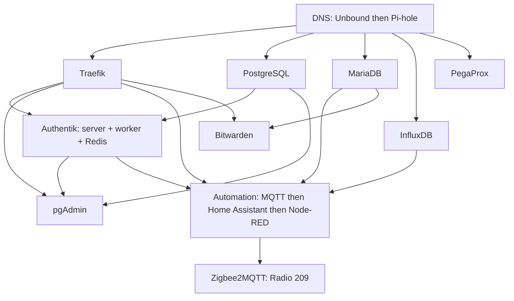

# HomeLab stack

A copyable implementation of a small Proxmox homelab. This repository composes the
reusable **homelab** framework into guests and applications. A private
**homelab-site** repository adopts a reviewed stack version and supplies actual
settings and deployment controls.

The source is executable: profiles compile to the framework's guarded ordinary
packet; reusable workflows run infrastructure, preparation, and the real app jobs.
The addresses and MACs here are sanitized examples. Nothing here has been deployed
or published by this redesign.

Each guest expands to **Infrastructure -> Preparation -> Application(s)**.
Preparation installs a Linux baseline and, for container workloads, Docker/Compose
once. PostgreSQL, MariaDB and InfluxDB are native Debian guests. Authentik is one
application job covering its three containers. These are Debian LXC workflows;
VM application support has not been qualified.

Zigbee2MQTT is an active Debian LXC with one declared coordinator, Docker in shared
Preparation, and one Zigbee2MQTT application entity. Its profile enables guest
startup and boot startup; its container inherits `restart: always`. Infrastructure
uses the framework's registered host capability for the exact device. BPG owns
the active guest and leaves device attachment to that capability because Proxmox
refuses API-token device updates. Register the restricted forced-command helper
before accepting `restricted-host-device-capability-registered`; the framework's
stack contract documents operator registration. Normal reconciliation may attach
the declared device if absent and verifies it inside the running guest. It refuses
replacement, removal and pending device changes. There are no stopped deployment
stages or separate radio controllers.
The separately prepared data includes the existing configuration, device database
and coordinator backup. Deployment preserves the network identity and never opens
the radio from a configuration checker or rewrites Zigbee settings.

Automation's `app.published_services.mqtt` is the broker definition. It declares
the hostname, port, frontend/backend addresses and which address DNS publishes.
Radio references `automation.mqtt` at its backend address through
`app.service_connections`. The compiler derives its container hostname alias,
the Pi-hole record and the matching DNS verification from that definition. An
address or hostname change therefore updates all of them together. Firewall
validation checks both ends of the MQTT connection. Pi-hole reconciliation updates
only the selected hostnames, preserves unrelated aliases and records, and restarts
only Pi-hole when the actual records change.

| File | Purpose |
| --- | --- |
| [stack.json](stack.json) | Guest dependencies, prerequisite names and central example values |
| [common.json](common.json) | Shared runner paths and PVE connection shape |
| [images.json](images.json) | Image selection authority |
| [guests](guests) | Executable profiles and public vendor keys/config templates |
| [deploy workflow](.github/workflows/deploy.yml) | Generated guest groups and real dependency edges |
| [phase workflow](.github/workflows/phase.yml) | The single framework revision selection |
| [site.example.json](site.example.json) | Empty private overlay shape |

Follow [setup and local tests](docs/setup.md), [secrets and prerequisites](docs/secrets.md),
[public-source policy](docs/public-boundary.md) and [adoption](docs/adoption.md).
Public pushes and pull requests run source CI only. Deployment is called from the
private site after deliberate pin adoption and reviewed merge. Every declared
guest participates by default. The optional `disabled` input defaults to `[]`;
only named exclusions are skipped. Invalid prerequisites fail validation instead
of silently disabling a guest. The public example is an offline input fixture.

The composition covers eleven prepared guests, including Zigbee2MQTT. Other fleet
applications, optional image updates and recovery projects are outside this redesign.
Monitoring source components remain in the framework; this stack
does not deploy an additional monitoring guest.

Guest definitions combine a framework blueprint with a profile under `guests/`,
the dependency entry in `stack.json` and private-site overrides. For example,
[MariaDB's profile](guests/mariadb/profile.json) selects VMID 206, one CPU,
1024 MiB RAM, a 4 GiB root disk and 16 GiB at `/var/lib/mysql`. Its blueprint
selects Linux preparation and the MariaDB application phase; the stack makes it
depend on DNS. The profile also supplies pinned packages, repository/configuration
files, interfaces, firewall rules and health checks. Actual addresses and keys
are supplied by the private site. No Actions jobs are written inside a profile.

The selected framework's `blueprints/workflows.py` generates `deploy.yml` and all
`guest-*.yml` workflows from the catalogue and stack dependencies. Edit those
declarative inputs and regenerate; the checked-in generated files are not edited
by hand. CI rejects stale generated files. The literal framework selection in
`phase.yml`, source CI and private-site exclusions remain explicit controls.

HTTP applications expose named endpoints, while the separate `routes` map owns
hostnames and optional middleware references. Managed routes compile to Proxmox
Notes; external NAS/host/Pi routes compile to the Traefik file provider. DNS records
point their hostnames to ingress. Read [the routing contract](docs/routing.md) for
examples, TLS trust, middleware definitions and explicit firewall requirements.
