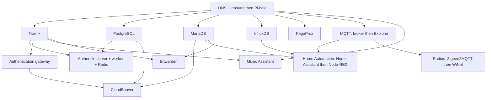

# HomeLab stack

A copyable implementation of a small Proxmox homelab. This repository composes the
reusable **homelab** framework into guests and applications. A consuming repository adopts a reviewed stack version and supplies concrete
site bindings and deployment controls.

The source is executable: profiles compile to the framework's guarded ordinary
packet; reusable workflows run infrastructure, preparation, and the real app jobs.
Reusable profiles contain no allocation defaults; the separate runnable examples
use synthetic identities. The consumer owns reviewed deployment.

Each guest has one reusable workflow with one guest-named job. Its visible steps
are **Setup**, **Infrastructure**, **Prepare**, each application and **Zabbix agent**
when selected. Home Automation has **Home Assistant** and **Node-RED**; Radios has
**Zigbee2MQTT** and **WiNet**. Shared framework actions keep phase-local validation,
credential scopes, locks, health checks and failure-stop behavior. The existing
45-minute phase caps and combined guest budget remain. GitHub may show its own
setup and cleanup entries.
Preparation installs a Linux baseline and, for container workloads, Docker/Compose
once. A selected root `zabbix:` adds one explicit **Zabbix agent** step after each
guest's applications, rather than repeating agent setup inside application steps.
PostgreSQL, MariaDB and InfluxDB are native Debian guests. Authentik is one
application phase covering its three containers. These are Debian LXC workflows;
VM application support has not been qualified.

**Radios** combines the logical Zigbee2MQTT and WiNet services. Its concrete guest
identity and hostname come from the consumer; image, data and coordinator
contracts stay with the profile.
It is an active Debian LXC with one declared coordinator, Docker in shared
Preparation, and one Zigbee2MQTT application entity. Its profile enables guest
startup and boot startup; its container inherits `restart: always`. Infrastructure
uses the framework's registered host capability for the exact device. BPG owns
the active guest and leaves device attachment to that capability because Proxmox
refuses API-token device updates. Register the restricted forced-command helper
before accepting `restricted-host-device-capability-registered`; the framework's
stack contract documents operator registration. Normal reconciliation may attach
the declared device if absent and verifies it inside the running guest. It refuses
replacement, removal and pending device changes. There are no stopped deployment
stages or separate radio controllers.
The separately prepared data includes the existing configuration, device database
and coordinator backup. Deployment preserves the network identity and never opens
the radio from a configuration checker or rewrites Zigbee settings.

The dedicated MQTT guest's `app.published_services.mqtt` is the single broker
owner. It declares a consumer-bound internal hostname, port 1883, backend/client addresses and which
address DNS publishes. Home Assistant, Node-RED, Zigbee2MQTT and WiNet reference
`mqtt.mqtt` through `app.service_connections`. The compiler derives container
hostname aliases, the Pi-hole record and matching DNS verification. Both ends of
each declared connection must have an explicit firewall allowance. The source
preserves retained data and declared interfaces; it does not move broker data,
remove a conflicting owner, or rewrite client configuration. The consumer must
qualify prepared state and exclusive ownership before adoption. See [Music and MQTT](docs/music-mqtt.md).
Its **MQTT Explorer** step adds a browser client behind the existing identity
provider, using a separate dedicated account and saved profile. Broker operation
and existing clients are retained; see [MQTT Explorer](docs/mqtt-explorer.md).

| File | Purpose |
| --- | --- |
| [stack.json](stack.json) | Guest dependencies, prerequisites and required typed bindings |
| [common.json](common.json) | Shared runner paths and PVE connection shape |
| [images.json](images.json) | Image selection authority |
| [guests](guests) | Executable profiles and public vendor keys/config templates |
| [deploy workflow](.github/workflows/deploy.yml) | Generated guest workflow calls and real dependency edges |
| [phase selection](.github/workflows/phase.yml) | The single framework revision selection; not called by guest jobs |
| [site.example.yaml](site.example.yaml) | Explicit synthetic consumer fixture |

Follow [setup and local tests](docs/setup.md), [secrets and prerequisites](docs/secrets.md),
[public-source policy](docs/public-boundary.md) and [adoption](docs/adoption.md).
The [database-tools composition](docs/database-tools.md) keeps its existing guest
and adds CloudBeaver Community with an authenticated web gateway, original
metadata entries and dedicated PostgreSQL/MariaDB administration connections.
Public pushes and pull requests run source CI only. Deployment is called from the
private site after deliberate pin adoption and reviewed merge. Every declared
guest participates by default. The optional `disabled` input defaults to `[]`;
only named exclusions are skipped. Invalid prerequisites fail validation instead
of silently disabling a guest. The public example is an offline input fixture.

The composition covers thirteen base guests, including Radios, Music Assistant
and the dedicated MQTT broker. A root `zabbix:` additionally selects the existing
monitoring guest. Other fleet applications, optional image updates and recovery
projects remain outside this composition.

Guest definitions combine a framework blueprint with a profile under `guests/`,
the dependency entry in `stack.json` and private-site overrides. For example,
[MariaDB's profile](guests/mariadb/profile.yaml) requests one CPU,
1024 MiB RAM, a 4 GiB root disk and 16 GiB at `/var/lib/mysql`. Its blueprint
selects Linux preparation and the MariaDB application phase; the stack makes it
depend on DNS. The profile also supplies pinned packages, repository/configuration
files, interfaces, firewall rules and health checks. Concrete guest/network/storage identities and keys
are supplied by the consumer through declared typed bindings. No Actions jobs are written inside a profile.

CI has three separate workflows, each with its own purpose and progress:

| Workflow | When it runs | Checks |
| --- | --- | --- |
| [Validate stack](.github/workflows/validate-stack.yml) | Pull requests and pushes to main | Profiles, generated workflows, tests, 100% per-file coverage and complete-history source scanning |
| [Review PR dependencies](.github/workflows/review-pr-dependencies.yml) | Pull requests only | Changed dependency vulnerabilities |
| [Scan Python security](.github/workflows/scan-python-security.yml) | Pull requests and pushes to main | CodeQL Python analysis |

Their required check names remain `Source contracts`, `Dependency review` and
`CodeQL (python)`. The guest/deploy/phase workflows are separate reusable deployment
definitions, called by the private site; public CI uses synthetic fixtures.

The selected framework's `blueprints/workflows.py` generates `deploy.yml` and all
`guest-*.yml` workflows from the catalogue, stack dependencies and its authoritative
phase recipe. Each guest has one deployment job containing all its logical phases
in order. The existing phase commands, packet names, guest dependency edges,
runner/environment selection and credential step scopes are preserved. Phases
share one runner/workspace per guest, with a combined phase budget and bounded
steps; default step failure behavior stops later phases. Source checks establish
the configured job count and command/security contract. Actual run names, rendering and service
acceptance remain separate native checks. Edit the
declarative inputs and regenerate; the checked-in generated files are not edited
by hand. CI rejects stale generated files. The literal framework selection in
`phase.yml`, source CI and private-site exclusions remain explicit controls.

HTTP applications expose named endpoints, while the separate `routes` map owns
hostnames and optional middleware references. Managed routes compile to Proxmox
Notes; external NAS/host/Pi routes compile to the Traefik file provider. DNS records
point their hostnames to ingress. Read [the routing contract](docs/routing.md) for
examples, TLS trust, middleware definitions and explicit firewall requirements.

## Root Zabbix feature

An empty root `zabbix:` property in the private blueprint (JSON: `"zabbix": null`)
adds the **Zabbix** guest. Without that property, the existing thirteen base guests and
their packets remain unchanged. A boolean or custom object is rejected.

The monitoring profile requests Debian LXC, 2 CPUs/2 GiB RAM and 12 GiB
root storage; its guest identity and network/storage allocations are consumer bindings. It uses the management, PostgreSQL and InfluxDB networks and depends
on PostgreSQL and Traefik. The compiler creates the browser route, DNS and exact
monitoring firewall edges; existing guest dependency ordering remains intact.
The example domain is `zabbix.example.invalid`; real values belong in the site.

Every enabled guest receives an active Agent2 with a retained individual PSK.
Docker-capable guests get Docker monitoring; the owning PostgreSQL/MariaDB guests
manage dedicated statistics readers; InfluxDB supplies instance/health metrics.
The server uses the official Proxmox HTTP template and dedicated read-only token.
See the framework's `docs/zabbix-blueprint.md` for bootstrap/trust prerequisites,
first-install behavior, local Docker privilege scope and verification limits.
The optional workflow is skipped when the root property is absent; it does not
make any existing guest depend on the monitoring server.

The optional monitoring profile keeps exclusive-writer admission unconfirmed in
public defaults. Its private site must confirm its fresh guest slot. The framework
also derives the exact monitoring-to-PostgreSQL TCP5432 rules on both guests and
the InfluxDB metrics connection; these are not duplicated in the profile. With
root Zabbix selected, disabling only its server while other guests run is refused.
Existing disabled leaf selections and the ordinary guest dependency graph remain.

[WiNet](docs/winet.md) shares the existing radio guest with Zigbee2MQTT. Its
published upstream image is selected by digest; private inverter/MQTT options
remain controller inputs outside this repository.

Music Assistant and MQTT require genuine state, trust, writer and network
acceptance from the consumer. The separate synthetic examples are source-test
fixtures and do not establish that a live guest or network exists.

## Explicit site bindings

Reusable definitions contain logical relationships and resource requirements,
with concrete values declared by `required_site_bindings`. The consumer supplies
those values explicitly; production admission rejects missing bindings and known
synthetic address/domain identities. `site.example.yaml` is a synthetic input,
not a default configuration or production authority. Shared logical-network
bridge, VLAN and prefix bindings keep repeated assignments consistent.
