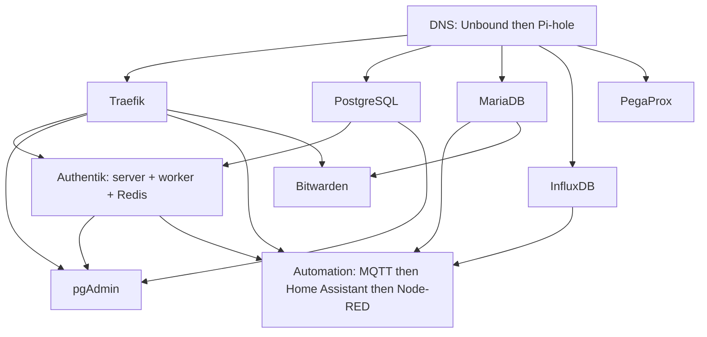

# HomeLab stack

A copyable implementation of a small Proxmox homelab. This repository composes the
reusable **homelab** framework into guests and applications. A private
**homelab-site** repository adopts a reviewed stack version and supplies actual
settings and deployment controls.

The source is executable: profiles compile to the framework's guarded ordinary
packet; reusable workflows run infrastructure, preparation, and the real app jobs.
The addresses and MACs here are sanitized examples. Nothing here has been deployed
or published by this redesign.

Each guest expands to **Infrastructure -> Preparation -> Application(s)**.
Preparation installs a Linux baseline and, for container workloads, Docker/Compose
once. PostgreSQL, MariaDB and InfluxDB are native Debian guests. Authentik is one
application job covering its three containers. These are Debian LXC workflows;
VM application support has not been qualified.

| File | Purpose |
| --- | --- |
| [stack.json](stack.json) | Guest dependencies, prerequisite names and central example values |
| [common.json](common.json) | Shared runner paths and PVE connection shape |
| [images.json](images.json) | Image selection authority |
| [guests](guests) | Executable profiles and public vendor keys/config templates |
| [deploy workflow](.github/workflows/deploy.yml) | Permanent guest groups and real dependency edges |
| [phase workflow](.github/workflows/phase.yml) | The single framework revision selection |
| [site.example.json](site.example.json) | Empty private overlay shape |

Follow [setup and local tests](docs/setup.md), [secrets and prerequisites](docs/secrets.md),
[public-source policy](docs/public-boundary.md) and [adoption](docs/adoption.md).
Public pushes and pull requests run source CI only. Deployment is called from the
private site after deliberate pin adoption and reviewed merge. The example site
enables no guests. This keeps unready workloads visibly present and disabled.

The composition covers the ten prepared guests. Zigbee2MQTT's separate owner work,
other fleet applications, optional image updates and recovery projects are outside
this redesign. Existing reusable Zabbix Agent tasks remain in the framework; this
stack does not invent missing per-guest machine IDs or PSK selections to enable them.
