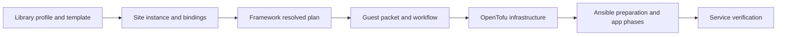

# How the library fits together

[Documentation index](README.md)

A **profile** declares what one logical application needs. A **site** chooses actual instances and binds those needs. A **guest** supplies the OS, resource budget, network interfaces and storage. An app instance has its own persistent identity even when several instances share a guest.

Compilation stops before infrastructure or service execution. Protected CD owns the later path. A rendered Compose file or local image trial does not establish deployed acceptance.

## Four different relationships

| Relationship | Example | Effect |
| --- | --- | --- |
| Value reference | An app endpoint resolves another app's selected address/port | Supplies a value |
| Readiness | An explicitly selected broker `start` requirement | Orders selected app/guest work |
| Network policy | A site selects and binds an ordered fragment | Declares permitted traffic; no access is inferred from the connection |
| Persistent ownership | Same app/service/project/storage/credential owner across runs | Prevents adoption or relocation during ordinary updates |

An interface role is an app requirement, such as `web` or `broker`. It points at a named guest NIC, guest loopback or a private app network. It does not create a NIC. A listener is the actual socket contract; an endpoint advertises a supported way to reach it. An exposure separately selects DNS publication or HTTP routing.

## Defaults and identity

Templates supply defaults; explicit guest fields replace the corresponding defaults. There is no arbitrary recursive overlay language. Runtime requirements can raise the effective OS reserve, and all selected workload budgets must fit.

Display names are labels. Stable app IDs, service/project/network names, NIC slots/MACs, storage sources, runtime/custody paths and credential owners control persistent resources. Reorganizing YAML does not rename them. Read [templates](reference/templates.md) and [updates](guides/images-and-updates.md) before changing them.
