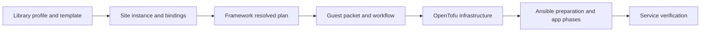

# How the library fits together

[Documentation index](README.md)

A **profile** declares what one logical application needs. A **site** selects app instances and connects their requirements to actual resources. A **guest** supplies the OS, resource budget, network interfaces and storage. An app instance keeps the same identity across deployments, even when it shares a guest with other instances.

Compilation generates configuration without changing infrastructure or running services. The site’s protected continuous-deployment workflow performs those later steps. Rendering a Compose file or trying an image locally does not verify a deployed service.

## Four different relationships

| Relationship | Example | Effect |
| --- | --- | --- |
| Value reference | An app uses another app's named endpoint. | Supplies that endpoint's selected address and port. |
| Readiness | A client connection explicitly selects broker readiness `start`. | Makes deployment start the broker before the client, ordering their app steps or guest jobs as needed. |
| Network policy | A site selects an ordered set of rules and connects its roles to site resources. | Declares which traffic is allowed; the connection itself grants no access. |
| Persistent ownership | The same app continues to own its services, Compose project, storage and credentials across deployments. | Prevents an ordinary update from taking over another installation or relocating its resources. |

An interface role is an app requirement, such as `web` or `broker`. It points at a named guest NIC, guest loopback or a private app network. It does not create a NIC. A listener defines the address and port where a service accepts connections. An endpoint tells other apps how to reach it. An exposure separately selects DNS publication or HTTP routing.

## Defaults and identity

Templates supply defaults; explicit guest fields replace the corresponding defaults. There is no arbitrary recursive overlay language. Runtime requirements can raise the effective OS reserve, and all selected workload budgets must fit.

Display names are labels. Stable app IDs; service, project and network names; NIC slots and MAC addresses; storage sources; runtime and protected-input paths; and credential owners determine which persistent resources HomeLab manages. Reorganizing YAML does not rename them. Read [templates](reference/templates.md) and [updates](guides/images-and-updates.md) before changing them.

## First installation and later deployments

`fresh` means the supported resource may be created if it is absent, and later ordinary deployments update that same managed instance. Keep `fresh` unchanged after installation; it is not a per-run toggle.

`retained` requires an instance that already exists and is HomeLab-managed. It refuses creation and does not import a foreign installation. Both policies can update an instance managed by HomeLab, subject to the selected profile's actual lifecycle support. Some profiles cannot create a new installation. See each profile's **First installation** and **Later deployments** sections rather than assuming that a valid lifecycle setting can create and configure every application.

Guest and app policies are separate. An existing HomeLab-managed guest can host a supported new app with unused identities, enough resources and a supported storage location; this does not change its existing peers' data ownership. [Compose a site](guides/compose-a-site.md) shows the declarations.
