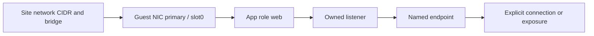

# Bind multiple interfaces

[Documentation index](../README.md) · [Compose a site](compose-a-site.md)

An app role names a need; a guest NIC names a provider interface. The site joins them. Keep network CIDRs, bridges/VLANs, NIC slots and concrete addresses at their owning site level.



## Physical role

The [HA example](../../examples/second/apps/home.yaml) binds:

```yaml
interfaces:
  web:
    interface: primary
```

`primary` exists in the app's selected guest. It is not a network ID or another app's role. An advertised web endpoint resolves through that role. A wildcard host listener may still listen across the host namespace; the advertisement is not evidence of isolation or a firewall grant.

Optional HA `database`, `metrics`, `broker` and `home` roles remain absent until their actual capability is selected. They may bind a declared NIC when the contract allows it; an app role does not add a NIC.

## Guest loopback and private app network

The [standalone Unbound instance](../../examples/minimal/apps/recursive_dns.yaml) uses:

```yaml
interfaces:
  service:
    scope: guest-loopback
  private:
    scope: app-network
    network: default
```

The container listens privately on port 53. Its profile publishes TCP/UDP to the guest's 127.0.0.1:5335. `private` describes the container network; `service` describes the advertised loopback endpoint. Selecting a physical NIC does not create a private network namespace. Unbound's service role deliberately rejects a physical binding.

## A broker has two advertisements, one owned listener

The MQTT profile advertises `backend` and `frontend` endpoints through corresponding physical roles. Both refer to the actual owned MQTT listener. They do not create two independent isolated container sockets. Explorer can save a DNS hostname while targeting the selected backend endpoint; the framework creates a hostname alias for Explorer alone.

## Route and health source choices

A guest's explicit `control_interface` selects its controller address/MAC independently of slot order, app roles or the default route. Guest preparation readiness uses that control interface. App health can select a declared source role where supported.

Static default_route selects the named network gateway. Static non-default NICs omit gateway; DHCP requires default_route:false and retains its supported gateway:null form. Source-policy routing, where supported, is an explicit separate guest declaration; app publication does not invent it.

For an explicitly selected `source_policy_route`, preparation maintains the guest-local helper and boot service, which checks the selected NIC before applying the reply policy. Correct entries stay unchanged; conflicting reserved entries refuse. This does not restart Docker or applications. An infrastructure NIC change may still require a provider-managed guest reboot. See the [source reply routing contract](https://github.com/theaussiepom/homelab/blob/6f5e40f50f33c3c3d0e6b06eadb7aa81e78572c7/docs/reference/guests.md#source-reply-routing), then verify actual reply routing after an authorized deployment or reboot.

Use the framework's [interface and source contracts](https://github.com/theaussiepom/homelab/blob/6f5e40f50f33c3c3d0e6b06eadb7aa81e78572c7/docs/reference/README.md) for exact bounds. The [template reference](../reference/templates.md) explains inherited resource/startup/security values; it does not allocate NICs.
